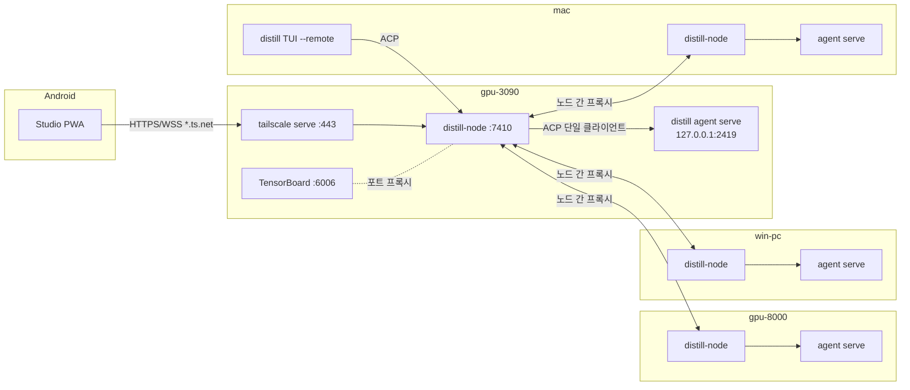

# Postudio — 기획안 v0.4

> **Postudio** = POStech + studio, AI 에이전트 연구 스튜디오. 엔진은 Distill, 서지 앱은 Potero.
> **지금의 목표: Distill 하네스를 멀티 호스트로 묶고 폰에서 쓴다.**
> 연구 앱(실험·NAS·서지·논문)은 UX가 불편해도 지금 하네스로 시도할 수 있으므로 백로그로 미룬다 → [`BACKLOG.md`](BACKLOG.md)

> **v0.5 제안**: 코드 재검토로 나온 변경 제안(R1~R12)과 병렬 실행 계획은 [`EXECUTION.md`](EXECUTION.md)에 있다. 2026-11-11에 전부 수용했다. 이 문서 본문은 아직 v0.4이고, 다른 곳과 어긋나면 `EXECUTION.md`가 우선한다.
> 실제 호스트 이름·tailnet 이름은 커밋하지 않는다. 별칭만 쓰고 실제 값은 `LOCAL.md`(git 제외)에 둔다.
---

## 0. 결정 기록 (v0.2 질문에 대한 답)

| # | 답 | 계획에 미친 영향 |
|---|---|---|
| 1 | Ubuntu RTX 3090 서버, Ubuntu RTX 8000 서버, Windows PC, macOS 랩탑, Android 폰. GPU 서버 off 시간은 겹치지 않지만 장애 점검으로 갑자기 내려갈 수 있음 | 호스트별 서비스 설치 3종(systemd/launchd/Windows). 호스트가 갑자기 꺼져도 화면이 깨지지 않아야 함(MVP 완료 기준) |
| 2 | NAS는 SMB/NFS 모두 가능하지만 설정 변경 불가, 이미 마운트된 경로만 사용 | NAS 스냅샷·Docker·쿼터 API 없음 전제 → 백로그 반영 |
| 3 | PyTorch + TensorBoard. 하네스에게 학습 스크립트와 TensorBoard를 띄우라고 시킴 | **MVP에 포트 프록시 포함**: 에이전트가 띄운 TensorBoard를 폰 iframe으로 본다 |
| 4 | Overleaf Git 연동 가능 플랜 | 백로그 Writing 확정 |
| 5 | POSTECH GenAI 미사용. 서지관리 AI 기능은 Distill이 담당 | 백로그 Library: Potero LLM 계층 → Distill |
| 6 | **Distill이 Gemini를 OAuth로 지원** | P2 하네스 확장에 Gemini OAuth provider 추가 (§10.1). `agy` 어댑터는 백로그로 |
| 7 | 지금은 멀티 호스트 + 폰 연결이 목적 | **MVP 범위를 좁힘** (§1) |
| 8 | 이름 후보 "porness / 포네스" | §13 참고 |

### v0.4 추가 결정

| 항목 | 결정 | 반영 |
|---|---|---|
| 이름 | **Postudio** (npm·crates.io 미사용, GitHub 동명은 0-star 개인 레포뿐) | 전체 |
| 기본 접속 서버 | **사용자가 지정**하고, 장애 시 사용자가 정한 순서로 대체 | §3, §6.3 |
| Tailscale | 이미 구성 완료 | S1 축소 (HTTPS 인증서·`serve`만 확인) |
| Gemini 계정 | 개인 Google AI Pro | §12.1, S9 |
| 작업 승인 | Claude Code식 **수동/자동 모드** → Distill에 이미 있는 권한 모드를 노출 | §6.2, §7, S10 |
| 서버 상주 | 두 Ubuntu 서버에서 **Orca 상주 성공** → 같은 방식으로 agent/node 상주 가능 | §8 |
| 레포 | **이 DistillCustom 레포를 바탕으로** Postudio 개발 (모노레포) | §11 |
| P0 결과 | S4·S8 PASS(코드), **S10 FAIL → 업스트림 패치 #1** | [`P0-RESULTS.md`](P0-RESULTS.md) |

---

## 1. 범위

| 단계 | 내용 | 상태 |
|---|---|---|
| **P0** | 기술 검증 스파이크 | 다음 작업 |
| **P1 = MVP** | **멀티 호스트 + 폰(Android) 원격 코딩 세션** | 이 문서의 본론 |
| P2 | 하네스 확장: Gemini OAuth, k-skill 기본 탑재, 터미널 | MVP 직후 (Gemini는 독립 트랙이라 병행 가능) |
| P3 | 원장(블록체인형 동기화) + 일반 모드 | P2 이후 |
| 백로그 | 실험 관리, Data/NAS, Library(Potero), Writing(Overleaf), CG 뷰어, agy 어댑터, 워크스페이스 초대 | `BACKLOG.md` |

**MVP 한 줄 정의**: Android 폰에서 4대 호스트의 Distill 세션을 보고, 새 작업을 시작하고, 잠금화면 푸시로 승인하고, 에이전트가 띄운 TensorBoard·이미지·HTML 결과를 확인한다. 같은 세션을 PC 브라우저와 TUI에서 동시에 본다.

---

## 2. 환경

| 호스트 | OS | 역할 | 비고 |
|---|---|---|---|
| `gpu-3090` | Ubuntu **컨테이너** | anchor, 학습 | nohup 상주 (Orca와 동일) |
| `gpu-8000` | Ubuntu **컨테이너** | anchor, 학습 (48GB VRAM) | nohup 상주 (Orca와 동일) |
| `win-pc` (`win-a` / `win-b` 중) | Windows | 코딩 | 작업 스케줄러/서비스. MVP에서 터미널·포트 목록 제외 |
| `mac` | macOS | 코딩 (자주 잠듦) | launchd |
| `phone` | Android | 클라이언트 | Tailscale 앱 + Chrome PWA. Web Push 제약 적음(iOS와 달리 홈 화면 추가 불필요) |
| NAS | — | 데이터 | 기존 마운트만 사용 |

fleet 도메인: `*.<tailnet>.ts.net` (MagicDNS + HTTPS 인증서 활성 확인).

네트워크: 5대 모두 **같은 Tailscale 계정의 tailnet**에 넣는다. 1인 사용이므로 ACL 태그 없이 기본 정책(내 기기끼리 허용)으로 시작한다.

---

## 3. MVP 아키텍처



핵심 결정 세 가지:

1. **node = ACP 다중화기**
   `agent serve`는 **가장 최근 연결 하나에만** 출력을 보낸다(`server.rs`의 `RelayDest` 교체 방식). 그래서 node가 에이전트의 **유일한 ACP 클라이언트**가 되고, 여러 UI(Studio 여러 개 + TUI)에 직접 나눠 준다.
   → 다중 연결 때문에 Distill을 고칠 필요는 없다. 단, 세션별 권한 모드 전환을 위해 **작은 패치 1개**가 필요하다(S10, §7.1).
2. **에이전트와 node는 별개 서비스**
   node를 재시작하거나 업데이트해도 실행 중인 세션과 백그라운드 프로세스(학습, TensorBoard)는 유지된다. `agent serve`는 재접속해도 세션을 유지하므로, node는 다시 붙기만 하면 된다.
3. **접속 node는 사용자가 지정한다**
   Studio는 **연결 우선순위 목록**(예: `gpu-8000 → gpu-3090 → win-pc`)을 갖고, 목록에서 처음으로 응답하는 node를 API 허브로 쓴다. 다른 호스트의 세션은 허브 node가 피어로 중계한다.
   Studio 정적 파일은 어느 node에서 받아도 같다. 앱은 출처(origin)와 무관하게 API 주소를 바꿀 수 있다(fleet 호스트끼리 CORS 허용). 그래서 PWA를 설치한 호스트가 점검 중이어도 서비스워커 캐시로 앱을 띄운 뒤 다음 순위 node에 붙는다(§6.3).

---

## 4. `distill-node` 명세 (MVP)

배포: Distill 바이너리의 서브커맨드 `distill node …`로 넣는다(설치·업데이트 공유). 코드는 `crates/custom/distill-node`.

### 4.1 CLI

```
distill node init            # 이 호스트를 첫 노드로: fleet 토큰, VAPID 키, 소유자 Tailscale 로그인 기록
distill node join <code>     # 다른 호스트 합류 (init이 출력한 1회용 코드)
distill node install-service # agent serve + node를 OS 서비스로 등록 (systemd user + linger / launchd / Windows)
distill node status          # 피어, 에이전트 연결, tailscale serve 상태
```

### 4.2 HTTP/WS API (127.0.0.1:7410 → `tailscale serve --https=443`)

| 경로 | 내용 |
|---|---|
| `GET /` | Studio 정적 파일 (바이너리에 내장) |
| `GET /api/node` | 호스트 정보: OS, GPU(nvidia-smi/NVML), 버전, 에이전트 상태, 로그인된 모델 계정 |
| `GET /api/fleet` | 피어 목록 + 온라인 여부 (`tailscale status --json` → 각 피어 `/api/node` 탐침, 캐시) |
| `GET /api/sessions` | 이 호스트 세션 (ACP `session/list` 호출, S8) |
| `GET /api/fleet/sessions` | 전 호스트 집계 (피어 응답 없으면 `unreachable` 표시) |
| `GET /api/workspaces` | 최근 작업 경로 + git 브랜치/상태 |
| `POST /api/sessions` | 새 작업 `{cwd, worktree: bool, model, mode, prompt}` → `distill-fast-worktree`로 worktree 생성 → ACP `session/new` |
| `WS /ws/sessions/:id` | **SEP 이벤트 스트림** (§5). 접속 시 기록 재생 → 실시간. 입력: prompt, cancel, permission 응답, model/mode 변경 |
| `WS /acp` | 다중화된 **raw ACP** (TUI `--remote`용) |
| `/h/:host/*` | 피어 node로 중계 (노드 간 인증 §7) |
| `GET /api/ports` | 이 호스트의 리스닝 포트 + 프로세스명 (Linux/macOS) |
| `/p/:port/*` | localhost 포트 리버스 프록시 (TensorBoard 등) |
| `GET /api/files?path=` | 세션 산출물(이미지·HTML·PNG 플롯) 서빙. **세션 cwd/worktree 내부로 제한** |
| `POST /api/push/subscribe` | Web Push 구독 등록 (모든 피어에 전파) |
| `PUT /api/sessions/:id/mode` | 권한 모드(`ask`/`auto`/`always-approve`) + 계획 모드 on/off (§7.1) |

CORS: fleet 호스트의 `https://<host>.<tailnet>.ts.net` 출처만 허용하고 credentials를 포함한다. 그래서 어느 node에서 받은 Studio든 다른 node API를 호출할 수 있다.

### 4.3 ACP 다중화기 동작

| 상황 | 처리 |
|---|---|
| 클라이언트 → 에이전트 요청 | JSON-RPC id 재매핑 후 전달, 응답은 요청한 클라이언트에게만 |
| `session/update` 알림 | 해당 세션 구독자 전원에게 방송 + 세션별 이벤트 버퍼에 기록 |
| 에이전트 → 클라이언트 요청 (`session/request_permission`) | 구독자 전원에게 방송 + **Web Push**. **먼저 온 응답 채택**, 나머지 클라이언트에는 `permission.resolved` 전달 |
| node 시작 전에 생긴 세션 | 첫 구독 시 ACP `session/load`로 기록 재생 |
| 에이전트 연결 끊김 | 자동 재접속(백오프), UI에 상태 표시 |

---

## 5. SEP (Studio Event Protocol)

UI는 ACP를 직접 알지 않는다. node가 ACP를 SEP로 바꿔 보낸다. 나중에 다른 하네스(agy 등)를 붙이면 node에서 어댑터만 추가하면 된다.

```ts
type SEP =
  | { t: "session.state"; status: "running"|"waiting_permission"|"idle"|"error"; host; cwd; model; mode }
  | { t: "message.delta"; id; text }            | { t: "reasoning.delta"; id; text }
  | { t: "tool.start"; id; name; title; input } | { t: "tool.update"; id; output?; status }
  | { t: "tool.end"; id; ok; summary }
  | { t: "permission.request"; id; tool; title; options[] }
  | { t: "permission.resolved"; id; choice; by }
  | { t: "plan.update"; items[] }
  | { t: "artifact"; kind: "image"|"html"|"diff"|"file"; url|data; title }
  | { t: "usage"; tokens; cost } | { t: "turn.end" } | { t: "error"; message }
```

`artifact` 생성 규칙 (MVP):
- 툴 출력의 ACP `ContentBlock::Image` → image
- 에이전트가 만든/수정한 `.png/.jpg/.svg/.html` 파일 → 파일 경로를 `/api/files` URL로 바꿔 artifact
- 편집 툴 결과 → diff

---

## 6. Studio MVP (Android 우선)

### 6.1 프런트 베이스 (v0.2 결정 유지)

- 셸: **Potero 프런트**(SvelteKit 2, Svelte 5 runes, Tailwind 4)에서 레이아웃·스토어 패턴만 가져온다.
- 부품: **OpenWebUI**에서 Markdown 렌더러(코드블록·KaTeX·mermaid), 메시지 표시, 입력창만 이식한다. 5,899줄짜리 `Chat.svelte` 컨트롤러는 쓰지 않는다.
- 위치: `apps/postudio`, `adapter-static`으로 빌드해 node 바이너리에 내장.

### 6.2 화면

| 화면 | 내용 |
|---|---|
| **세션 보드** | 호스트별 그룹(온라인/오프라인/점검 중), 세션 상태 배지(실행·**승인 대기**·유휴·오류), 승인 대기 세션이 맨 위 |
| **세션** | 스트리밍 메시지, 추론(접힘), 툴 타임라인(접힘, 탭하면 출력), 이미지 인라인, HTML artifact 패널(sandbox iframe), diff(파일별), 승인 카드(1회 허용/항상/거부), 중단 버튼, 모델 선택, **모드 칩**(수동 ↔ 자동 ↔ 계획, TUI의 Shift+Tab과 동일) |
| **새 작업** | 호스트 → 최근 repo → worktree 토글(기본 on) → 모델 → 프롬프트 |
| **포트** | 호스트의 열린 포트 목록 → 탭하면 iframe/새 탭 (TensorBoard) |
| **설정** | **연결 우선순위**(드래그로 순서 변경, 호스트별 지연시간 표시), 새 세션 기본 권한 모드, 푸시 on/off, 테마 |
| **첫 실행** | 지금 접속한 호스트를 기본으로 제안 → fleet 목록에서 우선순위 지정 → 푸시 권한 요청 |

입력: 텍스트, 사진 첨부(카메라/갤러리 → ACP Image), 음성은 Android 키보드 음성 입력으로 충분.

### 6.3 PWA·푸시

- manifest + 서비스워커(셸 캐시). 연결 우선순위는 로컬 저장소(IndexedDB)에 둔다.
- **연결 흐름**: 앱 시작 → 우선순위 1번 node 탐침(타임아웃 약 2초) → 실패하면 다음 순위 → 연결된 node를 상단 바에 표시(`via gpu-8000`). 사용 중 끊기면 자동으로 다음 순위에 재연결하고, 1번이 돌아오면 복귀 여부를 묻지 않고 다음 앱 시작 때 복귀한다(세션 중 전환 최소화).
- 우선순위 목록 전체가 응답하지 않으면 마지막 세션 보드를 읽기 전용 캐시로 보여준다.
- 제약: PWA 설치 출처 호스트가 꺼진 상태에서 서비스워커 캐시까지 없으면(첫 설치 직후 등) 앱이 뜨지 않는다. 이때는 다른 호스트 URL로 직접 접속한다.
- Web Push(VAPID, Chrome → FCM). fleet 공통 VAPID 키를 쓰고 구독은 모든 node에 저장한다. 발송은 **세션 소유 호스트의 node**가 한다.
- 알림 종류: 승인 필요, 턴 완료, 오류, (선택) 장시간 무응답.
- 푸시는 Google 서버를 거치므로 Tailscale이 꺼져 있어도 도착한다. 알림을 열면 Tailscale 연결이 필요하다.

### 6.4 TensorBoard·포트 프록시

- 기본: `/p/:port/` 경로 프록시. TensorBoard는 **`--path_prefix=/p/6006`**으로 띄워야 경로가 맞는다. 하네스 지침(AGENTS.md/스킬)에 "TensorBoard는 `--path_prefix=/p/<port>`로 실행"을 넣는다.
- 경로 접두사를 못 맞추는 앱: 대안으로 `tailscale serve --https=<port>`로 포트를 HTTPS로 따로 노출한다 (P0에서 둘 다 확인).
- 학습 프로세스 지속성: MVP는 에이전트 백그라운드 작업에 의존한다(에이전트 서비스가 살아있는 한 유지). 에이전트 재시작에도 살아남게 하는 것은 백로그(Experiments).

---

## 7. 보안

| 구간 | 방식 |
|---|---|
| 사용자 → node | `tailscale serve`가 붙이는 `Tailscale-User-Login` 헤더가 **init 때 기록한 소유자 로그인**과 일치해야 함. 직접 포트 접근은 차단(node는 127.0.0.1에만 바인딩) |
| node → node | `join` 때 공유한 fleet 토큰 + 출발지가 tailnet 대역(100.64.0.0/10)인지 확인 |
| node → agent | loopback + `agent serve --secret` (node가 생성·보관) |
| HTML artifact | `sandbox` iframe(`allow-scripts`만, **`allow-same-origin` 금지**) → Studio API 접근 불가 |
| 파일 서빙 | 세션 cwd/worktree 하위만 허용, 심볼릭 링크 탈출 차단 |
| 포트 프록시 | localhost 포트만, node·agent 자체 포트 제외 |
| 승인 | §7.1 모드 체계를 그대로 사용. 폰의 "항상 허용"은 해당 세션 범위로만 |

### 7.1 작업 승인 = Claude Code식 수동/자동 모드

Distill에 이미 있는 체계를 그대로 노출한다 (`distill-pager/src/app/actions.rs` `PermissionModeKind`, `distill-tools` `SessionMode`):

| Postudio 표시 | Distill 값 | 동작 |
|---|---|---|
| **수동** | `ask` (`default`) | 툴 실행마다 승인 카드 + 푸시 |
| **자동** | `auto` | 빠른 경로가 아닌 툴은 **LLM 분류기**가 판단하고, 위험한 것만 승인 요청 (Claude Code auto mode와 같은 개념) |
| 전부 허용 | `always-approve` (yolo) | 모든 툴 자동 승인. **확인 다이얼로그 필수**, 기본 메뉴에서 숨김, worktree 세션에서만 허용 |
| **계획** | 세션 모드 `plan` | 읽기·계획만 하고, 승인 후 실행 |

- 기본값: 새 세션은 설정의 "기본 권한 모드"(초기값 **수동**)를 따른다. 폰에서 시작한 worktree 작업은 **자동**을 기본 제안.
- 전송: 계획 모드는 ACP `session/set_mode`, 권한 모드는 ACP 확장 알림 `x.ai/yolo_mode_changed`(`permission_mode`, `yolo_mode`, `clientIdentifier`).
- **S10 결과**: 이 확장 알림은 `origin_client.product`가 같은 **모든 세션**에 적용된다. node는 모든 세션의 단일 클라이언트이므로 한 세션만 바꿀 수 없다.
  → **업스트림 패치 #1**: params에 선택 필드 `sessionId`를 추가해 있으면 그 세션에만 적용한다(없으면 기존 동작). `distill-shell`만 수정하며 약 20~40줄 + 테스트.
- 세션 생성 시에는 패치 없이도 `session/new`의 `_meta.yoloMode`/`_meta.autoMode`로 세션별 초기 모드를 지정할 수 있다.
- Auto 게이트 기본값은 `true`다(env `GROK_AUTO_PERMISSION_MODE`, `[auto_mode] enabled`로 끌 수 있음).

---

## 8. 운영 (OS별)

| OS | agent serve / node | 비고 |
|---|---|---|
| Ubuntu (두 대 모두 컨테이너) | **nohup 방식** (Orca와 동일). `distill node up`이 agent와 node를 setsid로 분리 실행하고, pidfile·로그는 `~/.distill/run`, `~/.distill/logs`. **멱등(idempotent)**: 살아 있으면 아무것도 안 함. node는 agent pidfile을 감시해 죽으면 재시작 | 컨테이너가 재시작되면 프로세스가 사라진다 → Orca를 다시 띄우는 시점에 `distill node up`도 같이 실행(또는 셸 로그인 훅). 컨테이너 tailscaled가 userspace 모드면 node 간 나가는 연결에 SOCKS5/HTTP 프록시 필요 |
| macOS | launchd LaunchAgent 2개 | 잠자기 → 오프라인 표시가 정상 동작 |
| Windows | 로그온 시 작업 스케줄러(또는 사용자 서비스) | MVP에서 `/api/ports` 제외, PTY 미지원(`ptyctl`이 unix 전용) |

`tailscale serve --bg --https=443 http://127.0.0.1:7410`은 `install-service`가 설정한다.

Tailscale은 이미 구성되어 있다. 추가로 필요한 것은 관리 콘솔에서 **MagicDNS + HTTPS 인증서** 활성화 여부 확인뿐이다(`tailscale serve` HTTPS 전제).

---

## 9. MVP 완료 기준 (전부 통과해야 완료)

1. Android(LTE + Tailscale)에서 `https://gpu-3090.<tailnet>.ts.net`을 PWA로 설치 → 4대 호스트와 세션이 온라인 상태와 함께 보인다.
2. 폰에서 `gpu-8000`에 **새 worktree 작업**을 시작한다 → 스트리밍과 툴 타임라인이 보인다.
3. 폰을 잠근다 → 승인 푸시가 온다 → 알림에서 열어 승인 → 작업이 이어진다.
4. 에이전트에게 "학습 스크립트와 TensorBoard 띄워"라고 지시 → 폰에서 TensorBoard iframe이 보인다. 폰을 닫아도 학습은 계속된다.
5. 같은 세션을 Windows 브라우저와 mac TUI(`--remote`)에서 동시에 연다 → 둘 다 실시간으로 갱신되고, 한쪽에서 승인하면 다른 쪽 카드가 닫힌다.
6. 에이전트가 만든 matplotlib PNG와 HTML 리포트가 폰에서 인라인 이미지와 iframe으로 렌더된다.
7. mac을 잠재우거나 우선순위 1번 서버를 내린다 → 해당 호스트는 오프라인으로 표시되고 다른 화면은 정상이다. 폰은 **사용자가 정한 2순위 node로 자동 재연결**되고 상단 바에 `via <host>`가 표시된다.
8. node를 재시작해도 실행 중인 세션과 학습이 끊기지 않는다.
9. 폰에서 세션 A를 **수동 → 자동**으로 바꾼다 → A는 위험하지 않은 툴을 승인 없이 진행한다. **같은 호스트의 세션 B는 수동 그대로다.** TUI에서 A의 모드 표시가 같이 바뀐다.

---

## 10. 작업 순서 (MVP)

| WP | 내용 | 선행 |
|---|---|---|
| WP1 | node 골격: HTTP 서버, 인증, `/api/node`, Studio 정적 서빙, `tailscale serve` 연동 | P0 |
| WP2 | ACP 다중화기 + SEP 변환 + `/ws/sessions/:id` + 기록 재생 | WP1 |
| WP3 | Studio 골격 + 세션 화면 (OWUI Markdown 이식) | WP2 |
| WP4 | 승인 카드 + Web Push | WP2, WP3 |
| WP5 | Fleet: 피어 탐색, 노드 간 중계, 세션 보드 집계 | WP1 |
| WP6 | 새 작업(worktree) + 모델/모드 선택 | WP2 |
| WP7 | 포트 프록시, artifact(이미지/HTML), diff | WP2, WP3 |
| WP8 | `init`/`join`/`install-service` (3개 OS) | WP1 |
| WP9 | `/acp` raw 다중화 → TUI 동시 접속 | WP2 |
| WP10 | §9 완료 기준 E2E 실행·기록 | 전부 |

---

## 11. P0 스파이크 (MVP 착수 전 확인)

| # | 확인할 것 | PASS 조건 |
|---|---|---|
| S1 | (tailnet 구성 완료) `tailscale serve` HTTPS 인증서, 신원 헤더, fleet 간 CORS | 폰 Chrome에서 각 호스트 HTTPS 응답, 헤더에 내 로그인, 호스트 A에서 받은 페이지가 호스트 B API 호출 성공 |
| S2 | `agent serve`가 Ubuntu/Windows/macOS에서 동작 + 재접속 후 세션 유지 | 3개 OS 모두 OK |
| S3 | ACP 다중화 시제품: 클라이언트 2개 + 권한 요청 방송 | 둘 다 스트림 수신, 한쪽 승인 반영 |
| S4 | `session/load` 기록 재생 형태 | 재생 이벤트로 화면 복원 가능 |
| S5 | Android Web Push (VAPID → FCM) | 잠금화면 알림 → 탭 → 해당 세션 열림 |
| S6 | TensorBoard `--path_prefix` 프록시 vs `tailscale serve --https=<port>` | 둘 중 하나 이상 폰 iframe 동작 |
| S7 | Studio 빌드: Potero 셸 + OWUI Markdown 컴포넌트(legacy 문법) 혼용 | Svelte 5 빌드 성공, 렌더 정상 |
| S8 | Distill 세션 저장소를 node 크레이트에서 읽기 (`~/.distill` / `~/.grok`) | 세션 목록과 메타 획득 |
| S9 | Gemini 개인 Pro 계정으로 Code Assist 로그인 → `loadCodeAssist` 티어 확인 → 함수 호출 1회 + thought signature 왕복 (P2 트랙용, 병행) | 스트림 응답과 툴 호출 왕복 성공, 티어·쿼터 기록 |
| S10 | node를 단일 클라이언트로 둔 상태에서 권한 모드 전환: `x.ai/yolo_mode_changed`가 세션 단위로 적용되는지, `auto_mode_gate` 조건 | 세션 A만 바뀜(완료 기준 9). 안 되면 업스트림 패치 범위 산정 |
| S11 | 서비스워커 캐시 + 출처 호스트 다운 시 다른 node로 재연결 | 1순위 호스트를 끈 상태에서 설치된 PWA가 2순위로 동작 |

결과는 `plan/research-base/P0-RESULTS.md`에 기록하고 계획을 갱신한다.

---

## 12. MVP 이후

### 12.1 P2 — 하네스 확장

#### Gemini OAuth provider (독립 트랙, MVP와 병행 가능)

기존 `claude_auth.rs`(1.3k줄), `codex_auth.rs`(2.1k줄)와 **같은 형태**로 만든다: 자체 토큰 저장소, 자체 갱신, 요청마다 bearer를 읽는 resolver. 다른 도구(gemini-cli, Antigravity)의 자격증명은 건드리지 않는다.

대상 계정: **개인 Google AI Pro**. 개인 계정은 Workspace와 달리 GCP 프로젝트를 직접 만들지 않아도 Code Assist 온보딩이 될 것으로 예상하지만, 티어 이름·쿼터·사용 가능 모델은 S9에서 실측해 기록한다.

폰에서도 쓰려면 로그인은 **각 호스트에서 한 번씩** 한다(자격증명은 호스트 간에 복제하지 않는다는 원칙). 헤드리스 서버(GPU 2대)는 loopback 브라우저가 없으므로 **수동 코드 붙여넣기 흐름**을 지원해야 한다. 이 로그인도 Studio에서 진행할 수 있게 한다(node가 인증 URL을 띄우고 폰에서 Google 로그인 → 코드 전달).

| 구성 | 내용 |
|---|---|
| 로그인 | `distill login --gemini`: Google OAuth(PKCE, loopback). 기본 계약은 공개 소스인 **gemini-cli의 Code Assist 흐름**. 값은 `DISTILL_GEMINI_*` 환경변수로 덮어쓸 수 있게 |
| 온보딩 | Code Assist `loadCodeAssist` → 티어·프로젝트 확인, 필요 시 `onboardUser` → 프로젝트 id 저장 |
| 새 API 백엔드 | `ApiBackend`(현재 ChatCompletions/Responses/Messages)에 **`GeminiCodeAssist`** 추가: `v1internal:streamGenerateContent?alt=sse` |
| 요청 매핑 | ConversationItem → `contents[]`(user/model, text·inlineData·functionCall·functionResponse), 툴 → functionDeclarations(**JSON Schema 호환 변환기**), systemInstruction, thinking 설정 |
| **thought signature** | Gemini 3 계열은 함수 호출 파트의 `thoughtSignature`를 다음 요청에 되돌려 보내야 한다 → 아이템의 공급자 전용 메타로 보존, 왕복 테스트 필수 |
| 응답 | SSE 파싱 → 텍스트/추론/툴 호출, `usageMetadata` → Distill 사용량 장부 |
| 모델 | `gemini/<id>` 카탈로그(티어별 가용 모델 조회). Flash 계열은 worker/utility 티어 후보 |
| 오류 | 429/쿼터 → 백오프 + 사용자 안내, 기존 Auto 계정 건너뛰기 로직과 연동 |
| 변형 | Antigravity OAuth(Gemini 3 + Claude 모델 쿼터)는 **실험 플래그, 기본 off**. 엔드포인트·조건은 별도 조사 |
| 테스트 | 매핑 fixture, 스키마 변환기, signature 왕복, 스트림 파서. 실제 호출 스모크는 opt-in |

약관 고지: `claude_auth.rs`의 기존 고지와 같은 원칙이다. 공식 문서화된 서드파티용 경로가 아니므로 서버 측에서 거부되거나 약관에 위배될 수 있다. 문서와 로그인 화면에 명시한다.

#### k-skill 기본 탑재 (v0.2 §6 유지)
- 스킬 탐색 루트에 `~/.agents/skills` 추가 (현재 Distill은 `.grok/.claude/.cursor` 아래 `skills/`만 탐색), 실제 경로 기준 중복 제거
- `distill skills install k-skill` (`npx -y @nomadamas/k-skill@0 update` 래핑, Node 18+)
- **142개 스킬 설명(약 35KB)을 매번 넣지 않는다** → 색인 + 턴별 상위 k개 주입 + `skill_search` 툴
- k-skill hard rule(결제·발송·제출 전 승인) → Studio 승인 카드 + 푸시

#### 기타
- 터미널: Linux/macOS는 `ptyctl` ↔ xterm.js. Windows는 ConPTY 별도 구현
- 파일 브라우저 (NAS 마운트 포함, 읽기 위주)

### 12.2 P3 — 원장 + 일반 모드 (v0.2 §7 설계 유지)

- 호스트별 단일 작성자 서명 해시체인을 상호 복제한다. 합의 없이 데이터 타입별 병합 규칙으로 처리한다. GPU 서버 2대가 anchor다.
- 장애 점검으로 anchor 하나가 갑자기 내려가도 다른 anchor가 ack한다. 둘이 동시에 내려간 동안의 쓰기는 작성 호스트에 보관했다가 나중에 전파한다.
- 일반 채팅·메모리·노트·세션 색인·푸시 구독을 이전한다.
- 완료 기준: GPU 서버를 순차로 내린 상태에서 작성 → 재가동 후 수렴, 변조 엔트리 거부.

---

## 13. 이름 — **Postudio** (확정)

| 구성 | 이름 |
|---|---|
| 제품 전체 / 웹 앱 | **Postudio** (문서의 "Studio") |
| 호스트 데몬 | Postudio node (`distill node` 서브커맨드, 엔진과 함께 배포) |
| 하네스 엔진 | Distill (커스텀 포크) |
| 서지 앱 | Potero → Postudio Library (백로그 B3) |

레포 경로는 `apps/postudio`.

---

## 14. 위험 (MVP 기준)

| 위험 | 대응 |
|---|---|
| ACP 다중화 엣지 케이스(동시 프롬프트, 승인 경합) | 세션당 프롬프트 큐 1개, 승인은 선착순 + 결과 방송, S3에서 검증 |
| `session/load` 재생이 화면 복원에 부족 | node 세션 이벤트 버퍼 + 필요 시 transcript 파일 직접 파싱 |
| 연구실 서버 정책(서비스 상주, Tailscale 설치) | user-level systemd, sudo 불필요 경로 우선. 막히면 관리자와 협의 |
| GPU 서버 장애 점검 | 폰 대체 호스트 전환, 세션 보드에 오프라인/점검 상태 표시 |
| Windows 기능 공백 | MVP는 세션·승인·artifact만, 터미널·포트는 P2 |
| OWUI 부품 이식 비용 | S7에서 측정, 과하면 Markdown 렌더러만 이식하고 나머지는 직접 작성 |
| 업스트림 drift | MVP 패치는 #1(세션별 권한 모드) 하나. 모든 패치는 `PATCHES.md`로 관리 |
| 작업 트리의 미커밋 변경(`distill-pager`) | Postudio 작업은 `crates/custom/`, `apps/postudio/`, `distill-shell` 패치 #1에 한정해 충돌 회피 |

---

## 15. 남은 질문

1. **Windows 기기**: `win-a`(online)와 `win-b`(offline) 중 어느 쪽이 쓸 PC인가?
2. **컨테이너 안 tailscaled 실행 방식**: `--tun=userspace-networking`인가? (맞다면 `--socks5-server` 또는 `--outbound-http-proxy-listen` 필요 여부 확인)
3. **서버 검증 경로**: 두 서버에 Tailscale SSH를 켜서(`tailscale set --ssh`) 이 Mac에서 검증할지, 서버에서 직접 스크립트를 돌릴지
